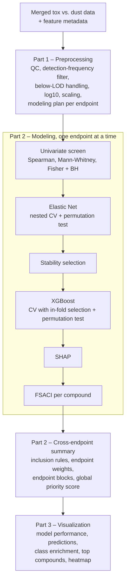

# INQUIRE_TIP – Toxicity-Informed Prioritization

**INQUIRE_TIP** (INQUIRE Toxicity-Informed Prioritization) is a Python/JupyterLab pipeline that links chemical features detected in environmental samples by non-target screening to the results of toxicity tests (bioassays) on the same samples. For every toxicity endpoint it finds the chemical features whose concentrations go together with higher toxicity, and ranks them so that the most consistent and influential candidates can be followed up.

The pipeline combines **Elastic Net** regression, **stability selection**, **XGBoost** (eXtreme Gradient Boosting) and **SHAP** (SHapley Additive exPlanations) into one ranking score per compound and endpoint, the **FSACI** (Final Stability-Adjusted Compound Index). Depending on the distribution of each endpoint, it runs a **regression** (continuous endpoint) or a **classification** (active vs. inactive) task. All performance figures are cross-validated and tested against permutations, and endpoints without a reliable model are excluded from the final cross-endpoint ranking.

INQUIRE_TIP was built for and applied to house dust analyzed by GCxGC-MS (non-polar constituents) and LC-MS (polar constituents) based non-target screening, with 11 in vitro toxicity endpoints (cytotoxicity, inflammation markers IL-6 and IL-8, AhR activity, androgen, anti-androgen, estrogen, anti-estrogen and thyroid receptor activity). It can be used with other sample types, analytical platforms and endpoints that have the same data structure (one row per sample, one column per endpoint and per chemical feature).

> **NB!** The rankings are **statistical associations**, not proof that a compound causes the effect. A compound can rank high because it co-occurs with the active compounds. Confirm top candidates, e.g., with the literature, effect-directed analysis or tests of the pure compounds.

## How it works



## Pipeline parts

| Part | Notebook | What it does | Main output |
|---|---|---|---|
| 1 | `INQUIRE_TIP_Pt1_Preprocessing.ipynb` | Reads and checks the merged tox vs. dust data and the feature metadata; filters, transforms and scales the dust features; suggests the modeling task per endpoint | `<yymmdd>_dust_detfilt_log10.csv`, `<yymmdd>_tox_endpoints_unscaled.csv`, `<yymmdd>_endpoint_modeling_plan.csv` |
| 2 | `INQUIRE_TIP_Pt2_Modeling.ipynb` | Models **one endpoint per run** (univariate screen, Elastic Net, stability selection, XGBoost, SHAP, FSACI); after all endpoints, builds the cross-endpoint summaries | `endpoint_models/<endpoint>/fsaci_rank_w_metadata.csv`, `cross_endpoint_summary/compound_global_summary_w_metadata.xlsx` |
| 3 | `INQUIRE_TIP_Pt3_Visualization.ipynb` | Publication-ready figures (PDF, SVG, PNG) and caption drafts | `inquire_tip_figures/fig1…fig5`, `figure_notes.txt` |

## Repository structure

```
INQUIRE_TIP/
├── README.md
├── INQUIRE_TIP_Manual.docx      user manual (all documentation in one Word file)
├── requirements.txt             exact package versions (pip)
├── environment.yml              same for conda
├── CITATION.cff                 citation metadata
├── LICENSE                      MIT license
├── notebooks/                   the three notebooks (run from here)
├── example_data/                synthetic test data (same formats as the real input) + README.md
├── data/                        working folder (DATA_DIR); only README.md in the repository
└── docs/
    ├── installation.md          software, environment, packages, folder structure, logs, reproducibility
    ├── input_data.md            input files, formats, mandatory columns, feature IDs, endpoints
    ├── 01_preprocessing.md      Part 1
    ├── 02_modeling.md           Part 2
    ├── 03_visualization.md      Part 3
    ├── parameters.md            all user-settable parameters
    ├── codebook.md              file map and every output file and column
    └── method_and_limitations.md  method, reference run, limitations, references
```

## Quick start

1. Install [Anaconda](https://www.anaconda.com/download) (or Miniconda) and create the environment:
   ```
   conda env create -f environment.yml
   conda activate inquire_tip
   ```

2. Copy the content of `example_data/` into `data/` (or put your own input files there, see [docs/input_data.md](docs/input_data.md)).
3. Start JupyterLab from the repository folder (`jupyter lab`) and open `notebooks/`.
4. Run **Part 1** (*Kernel → Restart Kernel and Run All Cells*).
5. Run **Part 2** once per endpoint: set `ENDPOINT_SHORT` in the *Endpoint selection* cell, restart the kernel and run all cells down to the `# ML end` cell. When all endpoints are done, run the two cross-endpoint cells at the end of the notebook. For a quick test, set `FAST_MODE = True`.
6. Run **Part 3** (*Restart Kernel and Run All Cells*); set `IDENTIFIED_ONLY = True` and run it again for the figures with identified compounds only.

Details: [docs/installation.md](docs/installation.md), [docs/01_preprocessing.md](docs/01_preprocessing.md), [docs/02_modeling.md](docs/02_modeling.md), [docs/03_visualization.md](docs/03_visualization.md). The Word manual `INQUIRE_TIP_Manual.docx` contains all documentation in one file.

## Key points and limitations

- With far more chemical features than samples (in the INQUIRE data ~7,900 modeled features vs. 150–167 samples per endpoint), single models overfit easily. The pipeline therefore judges every model by **cross-validated** performance (Q² for regression, ROC AUC for classification; feature selection and tuning redone inside every training fold) and by a **permutation test**, and ranks compounds only by how **stable** and **influential** they are across subsamples and models.
- An endpoint enters the cross-endpoint ranking only if at least one model has **signal** (CV metric above chance, permutation p < 0.05) **and** a minimum effect size (default CV Q² ≥ 0.10 or CV AUC ≥ 0.60). In the INQUIRE reference run, 5 of the 11 endpoints passed (see [docs/method_and_limitations.md](docs/method_and_limitations.md)).
- FSACI ranks compounds **within** an endpoint; it is not an effect size and is not comparable between endpoints.
- Correlated compounds (same sources) share or split the credit; unidentified features can rank high. Rankings are hypotheses for follow-up, not causal conclusions.

## Data availability

The pipeline code and the synthetic example data are in this repository. The INQUIRE input data (merged tox vs. dust data, feature metadata) and results are not published with the pipeline.

## License

MIT license (code, documentation and synthetic example data), see [LICENSE](LICENSE).

## Citation

If you use this pipeline, please cite it as:

> Rebryk, Andriy (2026). INQUIRE_TIP – Toxicity-Informed Prioritization (version 1.0) [Software]. GitHub. https://github.com/r3bryk/INQUIRE_TIP

GitHub also shows a "Cite this repository" button based on `CITATION.cff`.

## Funding

Developed within the INQUIRE project, funded by the European Union (Horizon Europe grant agreement No. 101057499), UK Research and Innovation (UKRI; grants 10038689 and 10042425) and the National Health and Medical Research Council of Australia (NHMRC; grant 2022/GNT2017837).
